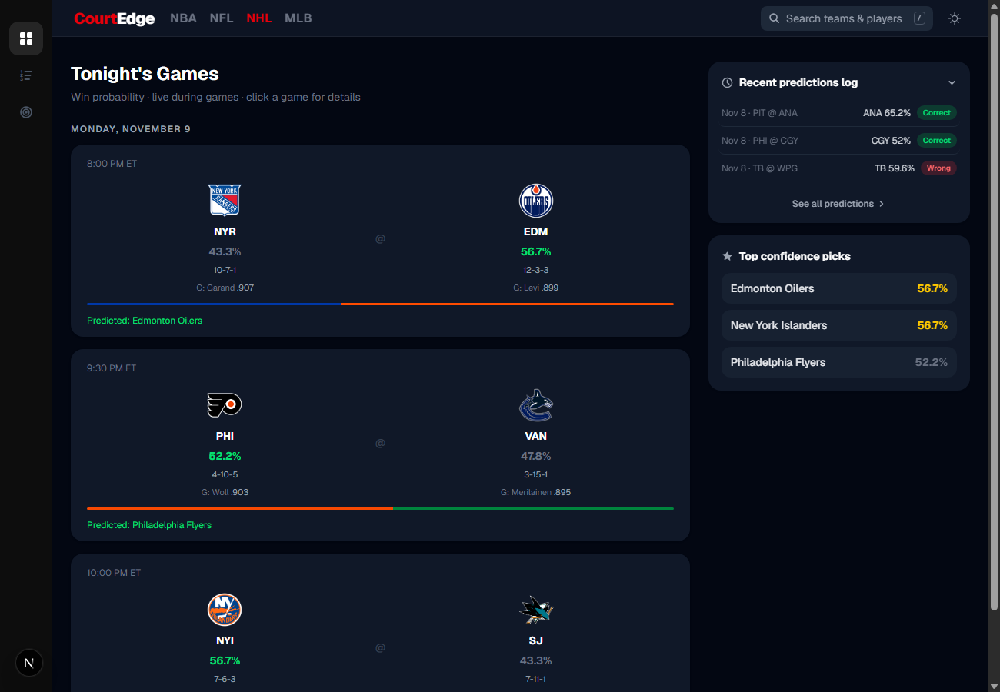
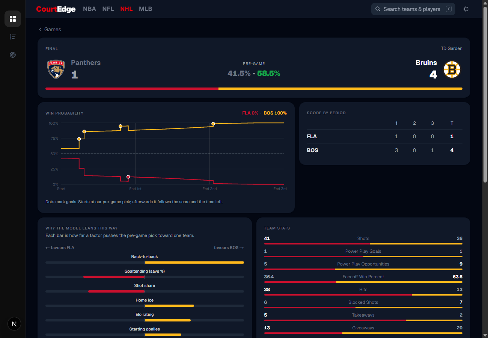
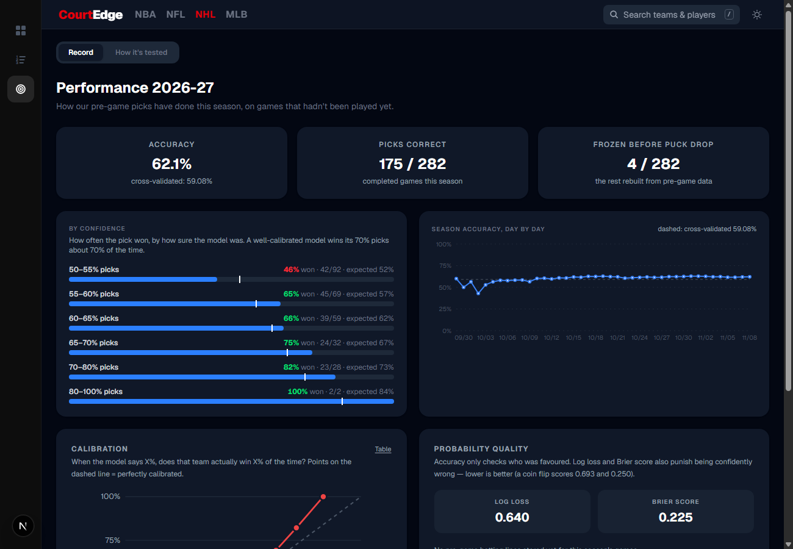
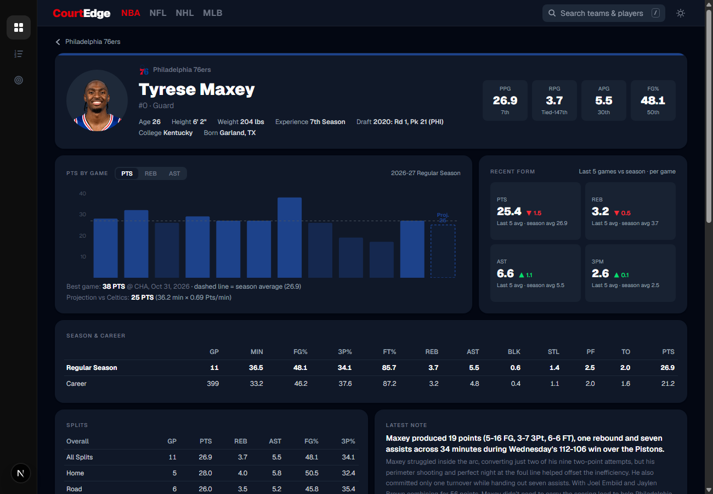
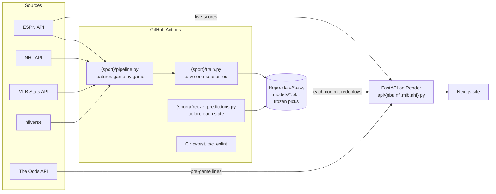

# CourtEdge

Win probabilities for every NBA, NFL, MLB and NHL game: before the game, live while it is played,
and a public record of how the picks did.

**Stack:** Python (pandas, scikit-learn, XGBoost) · FastAPI on Render · Next.js / TypeScript /
Tailwind · GitHub Actions for the daily data refresh, prediction freezes and CI.

| Games, probable goalies and live probabilities | NHL game page |
|---|---|
|  |  |
| **Season record of the picks** | **Player page with projections** |
|  |  |

## What it does

- **Pre-game win probability** for every game, from a model per sport trained on 5 to 12 seasons.
- **Live win probability** that follows the score and the clock (NBA, NFL, NHL), drawn as a chart on
  each game page with an explanation of why the model leans the way it does.
- **Honest record**: picks are frozen before each game starts and scored afterwards (accuracy,
  log loss, Brier score, calibration), next to the bookmakers' no-vig probabilities when a line was
  stored. A game is never re-predicted with information from after it started.
- **Season simulations**: playoff, division and title chances from 10,000 simulated seasons.
- **Team and player pages** for all four leagues, with next-game projections (NBA points, rebounds
  and assists; NFL yards; NHL points, goals, assists, shots), and a typo-tolerant search
  ("jamar" finds Ja'Marr Chase).

## Models

Every feature is computed game by game from what was known **before** the game. Validation is
leave-one-season-out: each season is predicted by a model that never saw it.

| Sport | Seasons | Games | Accuracy | Log loss | Main features |
|---|---|---|---|---|---|
| NBA | 2016–2026 | 14,168 | **66.0 %** | 0.616 | Elo, recent point margin, roster strength (last season's per-minute Game Score of today's players), rest, back-to-backs |
| NFL | 2015–2025 | 3,018 | **64.5 %** | 0.625 | Elo, EPA per play, starting quarterbacks, rest and travel. Vegas closing line on the same games: 66.2 % |
| MLB | 2021–2025 | 12,148 | **57.5 %** | 0.676 | Elo, starting pitchers' FIP to date, bullpen quality and fatigue, recent offense |
| NHL | 2015–2026 | 15,827 | **59.1 %** | 0.666 | Elo, shot share, goal differential, starting goalies' save % to date, rest, back-to-backs |

The served model is a logistic regression: as accurate as XGBoost here, better calibrated, and its
coefficients explain each pick. Baseball and hockey are the hardest sports to call: around 58–60 %
is what good public models reach.

## Architecture



- `{sport}/pipeline.py` walks every game in date order and writes the training rows, this season's
  pre-game rows and the live team table; `{sport}/train.py` validates and saves the model.
- The API (`api/`) is one module per area: `nba.py`, `nfl.py`, `mlb.py`, `nhl.py`, `teams.py`,
  `players.py`, plus shared `common.py` (app, background cache refresh), `espn.py`, `odds.py` and
  `record.py`. Slow pages are computed at startup and refreshed in the background, so visitors get
  cached answers.
- The site (`frontend/`) is a Next.js app with one section per sport.

## Run it

```bash
# API
python -m venv .venv && .venv\Scripts\activate        # Windows (macOS / Linux: source .venv/bin/activate)
pip install -r requirements-dev.txt
uvicorn api.main:app --reload --reload-dir api        # http://localhost:8000

# Site
cd frontend
npm install
npm run dev                                           # http://localhost:3000
```

The site reads `NEXT_PUBLIC_API_URL` (default `http://localhost:8000`). Betting odds need an
`ODDS_API_KEY` environment variable; without it the rest works.

Rebuild a model (raw downloads are cached in `data/{sport}/raw/`, git-ignored):

```bash
python nhl/pipeline.py && python nhl/train.py         # same for nba, nfl, mlb
```

## Tests

```bash
python -m pytest -q tests
```

They check the math (live win probability, value bets, season record), that each trained model
matches the features the API feeds it, and the endpoints that answer from the repo's own data.
The CI workflow runs them with the site's type check and lint on every push.

## Automation

| Workflow | When | What |
|---|---|---|
| `refresh-data.yml` | daily in season (NFL: Tuesdays) | pipelines, Monday retrains, commit → redeploy |
| `freeze-{nba,nfl,nhl}-predictions.yml` | before each slate | write down the pre-game picks |
| `keep-alive.yml` | every 10 min, daytime | keeps the free Render instance awake |
| `ci.yml` | every push | tests, type check, lint |
